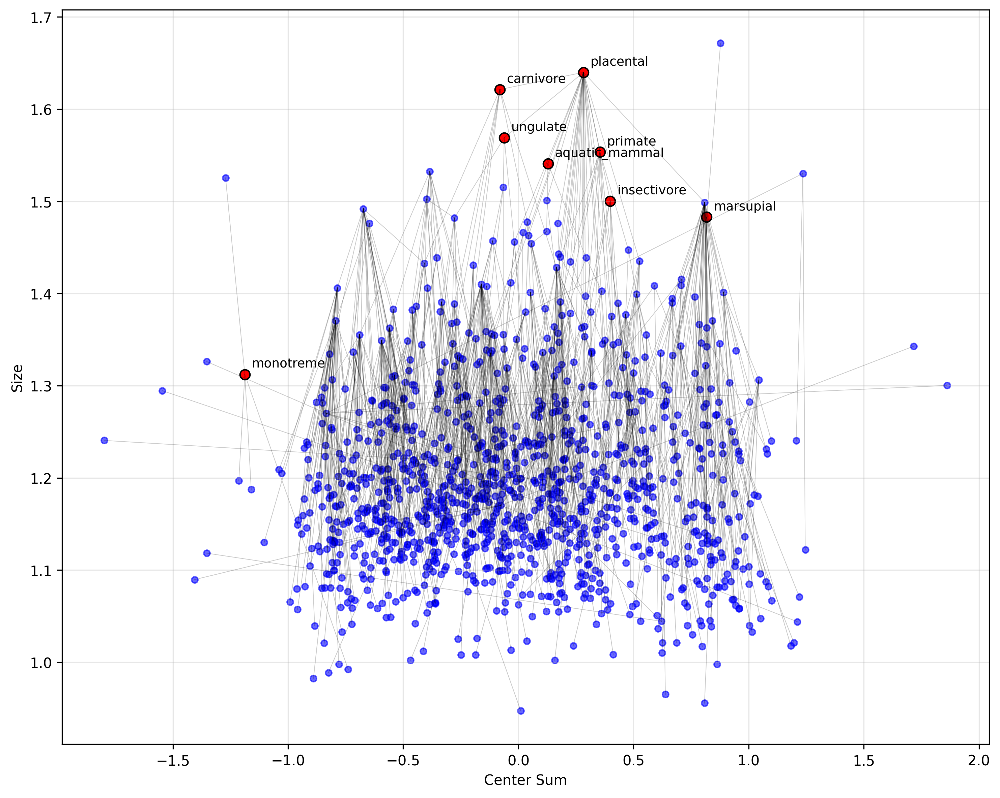

# Achieving Hyperbolic-Like Expressiveness with Arbitrary Euclidean Regions: A New Approach to Hierarchical Embeddings

## About

This is the implementation of RegD, a framework for embedding hierarchical data as regions in Euclidean spaces. 
This implementation is based on the [ShadowCones](https://github.com/ydtydr/ShadowCones) project.

## Illustration




The resulting embeddings are illustrated in `mammal_dim=2_ball.png`. In this figure, the x-axis represents the sum of the coordinates of each center (i.e., *x* + *y* for a center located at (*x*, *y*)), while the y-axis represents the corresponding radius. As shown in the figure, our embeddings effectively capture the hierarchical structure of the mammal dataset.


## Installation

### Requirements
- Python >= 3.9
- PyTorch >= 1.12.1

### Setup
 
```
# Create a new conda environment
conda create -n myenv python=3.9.20

# Activate the environment
conda activate myenv

# Install packages with specific versions
pip install \
    torch==2.5.0 \
    torchaudio==2.5.0 \
    torchvision==0.20.0 \
    six==1.16.0 \
    tqdm==4.66.5 \
    scikit-learn==1.5.2 \
    numpy==1.26.4 \
    gensim==4.3.3

```

### Dataset Preparation
1. First, unzip the `data_utils.zip` file in the project root directory.
2. Download the MCG and Hearst datasets using the following commands:
```bash
pip install gdown
gdown --no-check-certificate --folder https://drive.google.com/drive/folders/1WH2LIk2EsTe_lQ03AjCaxZ3o8fSkNt1f?usp=sharing
```
3. Move the downloaded datasets into the `data_utils` directory.

## Usage

### Training
To train the model, use the following command:
```bash
python train.py -dataset mammal -dim 2 -epoch 400 -lr 0.01 -mode box -hybrid 0 -lamda 1.0
```


### Parameters
- `dataset`: Name of the dataset to use (e.g., "mammal", "MCG", "hearst")
- `mode`: Type of region to use for embedding:
  - "box": Axis-aligned boxes
  - "ball": Spherical regions
- `hybrid`: Boundary distance calculation method:
  - 0: Use our boundary distance
  - 1: Use specific boundary distance for boxes/balls
- `lamda`: Weight for the depth distance in the energy function (default: 1.0)
- `dim`: Dimension of the embedding space (default: 2)
- `epoch`: Number of training epochs (default: 400)
- `lr`: Learning rate (default: 0.01)

For recommended hyperparameter settings and example commands, refer to `run.sh`.
