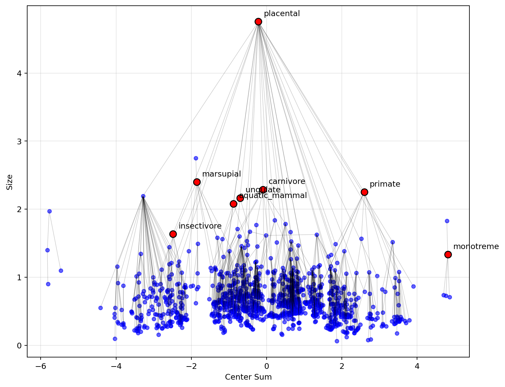

# RegD: Hierarchical Embeddings via Dissimilarity between Arbitrary Euclidean Regions

RegD embeds hierarchical data as regions in Euclidean space. Every node of an is-a graph becomes a box or a ball, and
"x is-a y" becomes "the region of x lies inside the region of y".



*The WordNet mammals as balls trained in 2 dimensions with this package. Every point is a node: the x-axis is the
sum of the coordinates of its centre, the y-axis its radius; the lines are the is-a edges. General classes get large
balls, their members small ones.*

This repository has two parts. Pick the one you need:

| you want to | go to |
|---|---|
| embed **your own** hierarchy | the `regd` package, described on this page |
| reproduce the experiments of the paper | [`paper/`](paper/README.md), the original code, unchanged |

## Try it in the browser

[](https://colab.research.google.com/github/HuiYang1997/RegD/blob/main/examples/quickstart.ipynb)

[`examples/quickstart.ipynb`](examples/quickstart.ipynb) installs the package, trains on a toy hierarchy and on the
WordNet mammals, and shows queries, evaluation, a picture of the regions and saving. It runs on CPU in a minute or two.

## Install

```bash
pip install git+https://github.com/HuiYang1997/RegD     # needs torch and numpy
pip install .                                           # or from a clone
```

## Quick start

```python
from regd import RegD

edges = [("dog", "mammal"), ("cat", "mammal"), ("mammal", "animal"), ("bird", "animal")]   # (child, parent)
model = RegD(dim=5, region="box").fit(edges)

model.is_a("dog", "animal")        # True / False
model.score("dog", "animal")       # lower = more likely; accepted when <= model.tau
model.ancestors("dog")             # [(name, score), ...] best first
model.descendants("animal", k=10)
model.save("animals.pt");  model = RegD.load("animals.pt")
```

`fit` accepts a list of `(child, parent)` pairs, a `networkx.DiGraph` (edge `u -> v` means "u is-a v") or the path
of a file with one `child<TAB>parent` pair per line.

The same from the command line:

```bash
regd train edges.tsv --dim 5 --region box --out model.pt
regd query model.pt dog              # predicted ancestors
regd query model.pt dog animal       # score and decision of one pair
```

## Choosing the settings

The defaults are meant to work as they are. If you change anything, these three choices matter most.

**1. Preset: what is your graph?**

| your graph | preset | what it does |
|---|---|---|
| the full hierarchy you want to embed | `strong` (default) | treats the graph as complete: a pair that follows from the edges (`a` is-a `b`, `b` is-a `c`, so `a` is-a `c`) is never used as a negative example |
| the same, and tree-like (e.g. WordNet) | `strong-bce` | as `strong`, with a BCE loss |
| incomplete, and you want to predict the missing edges | `predict` | assumes edges are missing: only the given edges themselves are never used as negatives, and nothing is inferred from them |

**2. Region:** `box` (default) or `ball`. Neither is better everywhere; try both if the result matters.

**3. Dimension:** start with `dim=5` (default). The benchmarks below use 2 to 10.

The other options you may want:

| option | default | meaning |
|---|---|---|
| `epochs` | 400 | passes over the edges |
| `lr` | 0.005 (box), 0.01 (ball) | learning rate |
| `lam_set` | `[0.5]` | weights of the depth term to try (see below) |

`lam_set` holds the weights of the depth term to try: with several values, e.g. `lam_set=[0, 0.5]`, `fit` trains
once per value and keeps the model with the best validation F1. In general, a larger `lam`
works better in low dimensions and a smaller one in high dimensions.

Example: `RegD(dim=10, region="ball", preset="strong-bce", epochs=200)`, or on the command line
`regd train edges.tsv --dim 10 --region ball --preset strong-bce --set epochs=200 --out model.pt`.

Everything else (losses, negative sampling, energies, schedules, text initialisation) has a sensible default and is
listed in [docs/options.md](docs/options.md).

## Working with a trained model

```python
model.summary()                        # size, options, validation F1, containment
model.containment()                    # share of training edges whose child region is inside the parent region
model.evaluate(pos_pairs, neg_pairs)   # precision / recall / F1 at model.tau
model.rank(pos_pairs)                  # MRR / Hits@k of the true parent among all nodes
model.regions()                        # node names, centres, offsets (numpy)
model.export("regions.tsv")            # or .npz
```

```bash
regd info   model.pt                 # size, options, validation F1, containment
regd eval   model.pt test_pos.tsv test_neg.tsv
regd export model.pt regions.tsv
regd plot   model.pt regions.png     # two of the dimensions (needs matplotlib)
```

If `containment()` is low, the regions do not nest and `is_a` works like a nearest-neighbour test; add 0 to `lam_set`
or lower the dimension.

**Validation data.** Training picks the checkpoint and the threshold `tau` on validation pairs. Pass your own with
`fit(edges, valid=(positive_pairs, negative_pairs))`. Without them, they are drawn from the graph itself.

## Pretrained models

Trained regions for WordNet, ready to load ([release `pretrained-v1`](https://github.com/HuiYang1997/RegD/releases/tag/pretrained-v1)).
Node names are WordNet synsets such as `dog.n.01`.

| file | graph | nodes | region, dim | test F1 | size |
|---|---|---|---|---|---|
| `wordnet_mammal_box_d5.pt` | WordNet mammals | 1,179 | box, 5 | 97.6 | 0.1 MB |
| `wordnet_mammal_ball_d5.pt` | WordNet mammals | 1,179 | ball, 5 | 99.0 | 0.1 MB |
| `wordnet_noun_box_d10.pt` | WordNet nouns | 82,114 | box, 10 | 53.6 | 10 MB |
| `wordnet_noun_ball_d10.pt` | WordNet nouns | 82,114 | ball, 10 | 60.8 | 10 MB |

```bash
wget https://github.com/HuiYang1997/RegD/releases/download/pretrained-v1/wordnet_mammal_box_d5.pt
```

```python
from regd import RegD
model = RegD.load("wordnet_mammal_box_d5.pt")
model.ancestors("bengal_tiger.n.01")
```

Each model also comes as `.npz` (arrays `nodes`, `center`, `offset` or `radius`, and `tau`) for use without this
package. The models are trained with `strong-bce` on the direct is-a edges (`scripts/pretrain.py`); test F1 is
measured on the paper's test pairs, which are pairs that follow from those edges.

Known limit: the threshold `tau` is tuned on such inferred pairs and can be too strict for the direct edges
themselves (for example, `wordnet_mammal_ball_d5` accepts only 36% of its own training edges). If you need the
direct edges, use the box models or compare `model.score(child, parent)` with 0 instead of `model.tau`.

## Results

Test F1 (%) on the 16 configurations of the paper (its splits and stored negatives; mammal 3 seeds, the others 2).
"paper (Table 2)" is the published number; the other two columns are runs of this package.

| data, region, dim | paper (Table 2) | `strong` | `strong-bce` |
|---|---|---|---|
| mammal, box, 2 | 64.9 | 90.8 | **95.9** |
| mammal, box, 5 | 71.6 | 93.7 | **96.7** |
| mammal, ball, 2 | 62.7 | 88.8 | **95.4** |
| mammal, ball, 5 | 71.8 | 95.0 | **98.6** |
| noun, box, 5 | 53.8 | 50.7 | **54.6** |
| noun, box, 10 | 51.3 | 48.6 | **53.9** |
| noun, ball, 5 | 58.4 | 50.0 | **59.7** |
| noun, ball, 10 | 59.1 | 54.9 | **62.7** |
| MCG, box, 5 | 50.7 | **71.5** | 62.7 |
| MCG, box, 10 | 58.5 | **72.5** | 61.0 |
| MCG, ball, 5 | 44.9 | 71.1 | **74.6** |
| MCG, ball, 10 | 46.8 | 76.4 | **78.0** |
| Hearst, box, 5 | 42.8 | **54.3** | 47.4 |
| Hearst, box, 10 | 49.6 | **60.2** | 51.1 |
| Hearst, ball, 5 | 37.7 | **52.7** | 46.4 |
| Hearst, ball, 10 | 37.7 | **58.6** | 58.1 |
| mean | 53.9 | 68.1 | 68.5 |

Per data set, the means are: mammal 92.1 / 96.6, noun 51.0 / 57.7, MCG 72.9 / 69.1, Hearst 56.4 / 50.7
(`strong` / `strong-bce`).

- `strong-bce` is better on the two WordNet graphs (mammal, noun), `strong` on the two extracted graphs (MCG, Hearst).
- With the `strong` presets every predicted relation is transitive.
- These numbers measure how well the regions reproduce a known hierarchy, not the prediction of unknown edges.

The effect of every option, dimension and `lam`, text initialisation, running time and how to reproduce the numbers:
[docs/results.md](docs/results.md).

## Relation to the paper

The model is the one of the paper: the same regions, boundary distance, depth dissimilarity, energy and loss. One
test checks that the package and the original code give the same numbers.

What the package changes is the training and the decision:

- negatives are re-drawn every epoch and never taken from the transitive closure of the training edges;
- a pair is accepted by a transitive rule (`b <= tau`, `tau <= 0`) instead of a free threshold on the energy.

The complete list, including what is left out of the package: [docs/relation-to-paper.md](docs/relation-to-paper.md).

## Repository layout

```
src/regd/    the package
tests/       its tests:  pip install ".[test]" && pytest
scripts/     benchmark scripts behind the result tables; pretrain.py made the pretrained models
runs/        the records of those benchmark runs
docs/        options.md, results.md, relation-to-paper.md
examples/    quickstart.ipynb, the notebook linked above
paper/       the original code of the paper, with its own README
```
